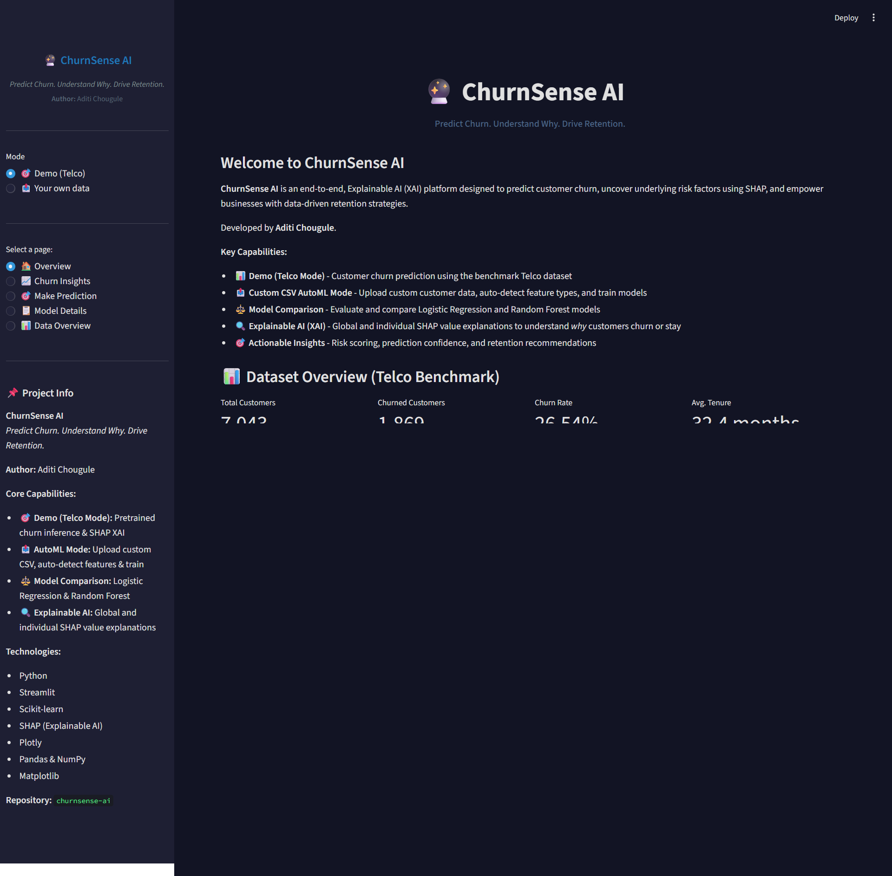
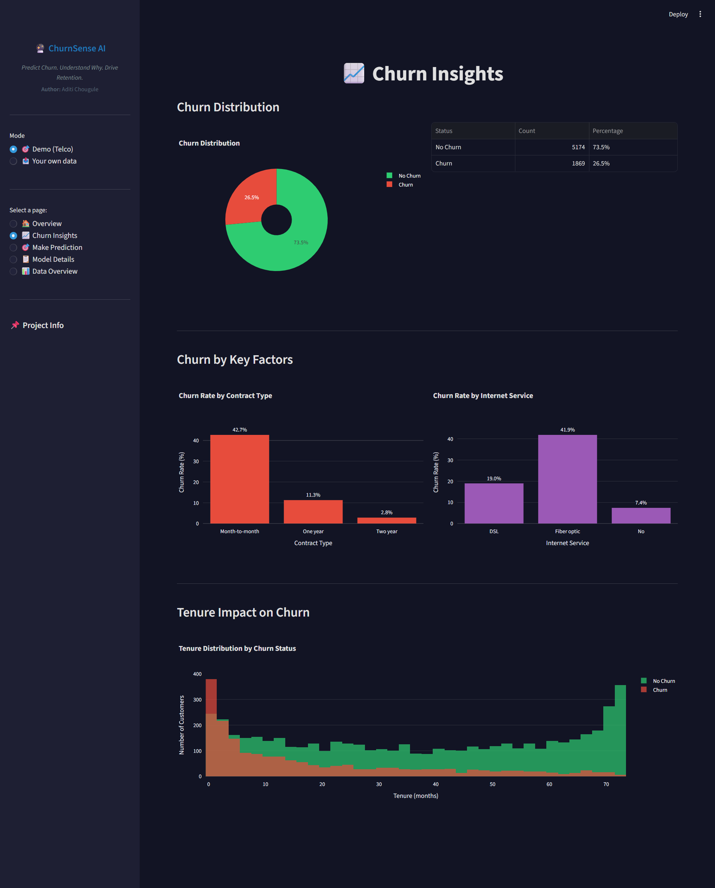
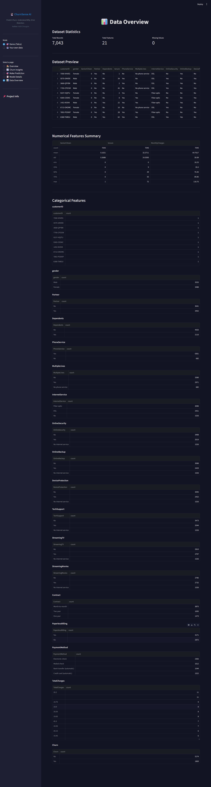
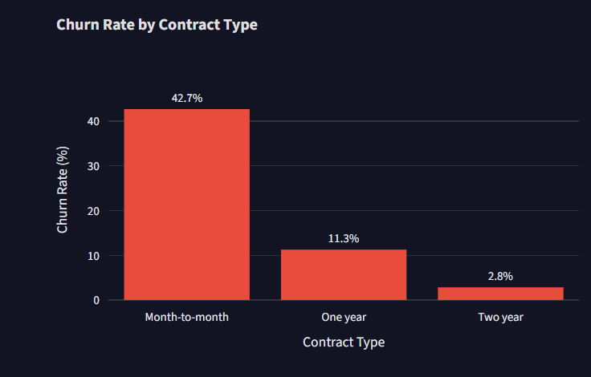
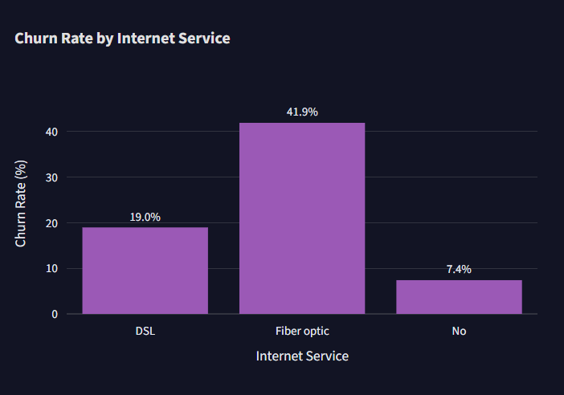
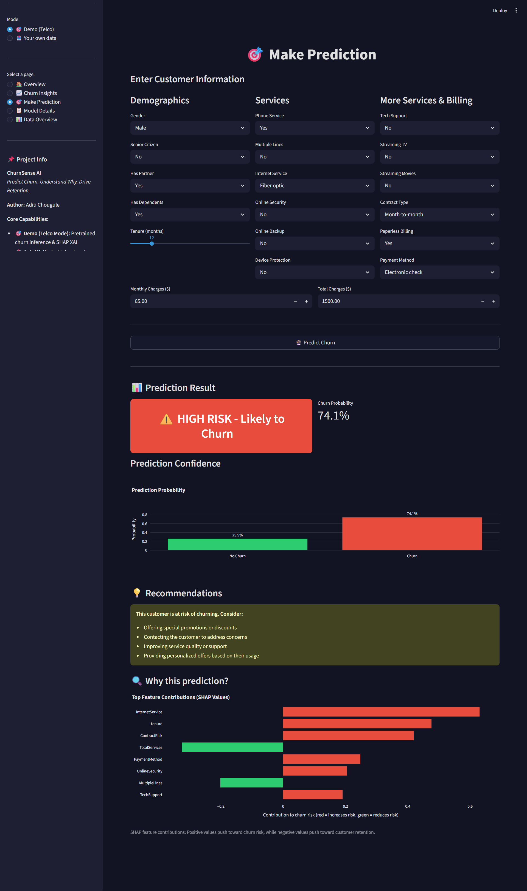
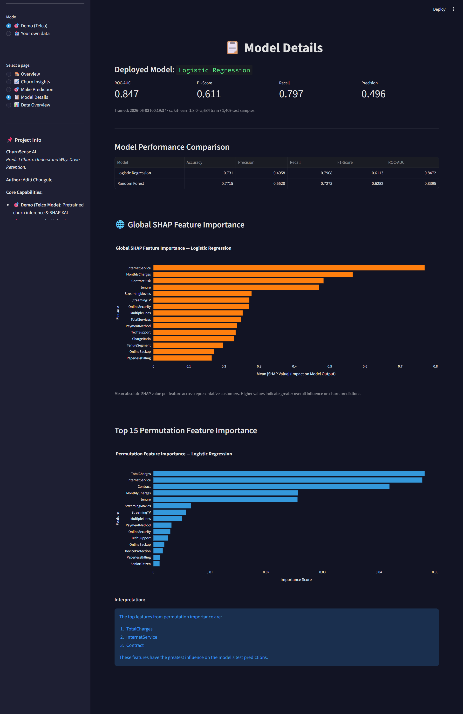

# 🧠 ChurnSense AI

> **Predict Churn. Understand Why. Drive Retention.**

An end-to-end Explainable AI (XAI) platform for customer churn prediction, featuring dual operational modes: **Demo (Telco Benchmark)** and **AutoML (Custom CSV)**. Powered by Scikit-learn, Streamlit, and SHAP to deliver transparent, actionable retention intelligence.

**Author:** Aditi Chougule  
**Repository:** [churnsense-ai](https://github.com/AditiChougule14/churnsense-ai)


---

## 🛠️ Case Study: From a Broken Model to ROC-AUC 0.85

This project originated with a critical architectural audit and transformation.

The initial baseline was non-functional — trained on synthetic random data, it predicted "No Churn" for every customer, while a train/serve bug silently dropped 5 inputs. An end-to-end refactoring (real Telco data + a single fit-once / serve-once pipeline) resolved the issues.

| Metric (held-out test set) | Baseline | ChurnSense AI |
|---|---:|---:|
| ROC-AUC | 0.49 (random) | **0.847** |
| Recall (churners caught) | 0.00 | **0.797** |
| F1-score | 0.00 | **0.611** |
| Customers flagged as churn | 0 / 7,043 | Realistic (~80% caught) |

Every prediction in **ChurnSense AI** is supported by model-based churn probability and risk assessment. SHAP explanations are used to help interpret the factors influencing predictions.

---

## 📋 Table of Contents

- [Overview & Core Capabilities](#-overview--core-capabilities)
- [Key Features](#-key-features)
- [Technology Stack](#-technology-stack)
- [Dataset](#-dataset)
- [Project Structure](#-project-structure)
- [Architecture](#-architecture)
- [Dashboard Screenshots](#-dashboard-screenshots)
- [Installation](#-installation)
- [Usage](#-usage)
- [API Service](#-api-service)
- [Model Performance](#-model-performance)
- [Explainable AI (SHAP)](#-explainable-ai-shap)
- [Testing](#-testing)
- [Author & License](#-author--license)

---

## 🎯 Overview & Core Capabilities

Customer churn is among the costliest business challenges. Identifying at-risk customers **before** they leave enables targeted, cost-effective retention. **ChurnSense AI** bridges machine learning and business action through full lifecycle modeling and explainability.

- 🎯 **Demo (Telco Mode):** Pre-trained on the Telco benchmark dataset across 5 dedicated dashboard pages (Overview, Churn Insights, Make Prediction, Model Details, Data Overview).
- 📤 **Custom CSV AutoML Mode:** Upload a CSV dataset with a binary target. Automatically detects numeric and categorical features, handles missing values, detects and ignores ID columns, trains models, evaluates performance, and provides interactive predictions.
- ⚖️ **Model Comparison:** Train, evaluate, and compare Logistic Regression and Random Forest models using 5-fold cross-validation on the training set to prevent test leakage.
- 🔍 **Explainable AI (SHAP-Based):**
  - **Global Explanations:** SHAP-based analysis to help understand overall model behaviour.
  - **Individual Explanations:** Customer-level explanations showing how input features influence churn predictions.
  - **Domain Aggregation:** One-hot encoded feature contributions are mapped back to their original domain columns for intuitive business interpretation.
- 💡 **Actionable Insights & Risk Scoring:** Classifies customer risk into Low, Medium, and High tiers with tailored retention strategies and downloadable trained pipelines (`.pkl`).

---

## ✨ Key Features

1. **Dual Operational Modes**
   - Seamlessly switch between the bundled Telco benchmark demo and custom CSV training in a unified Streamlit interface.

2. **Robust Preprocessing & Guardrails**
   - Fit-once / serve-once architecture helps eliminate train-serve skew.
   - Outlier protection, safe imputation, and `OneHotEncoder(handle_unknown="ignore")`.
   - Data validation guards against synthetic data, constant columns, non-binary targets, and single-class distributions.

3. **Transparent Model Interpretability**
   - SHAP integration supporting Linear and Tree-based explainers (`LinearExplainer`, `TreeExplainer`).
   - Mathematically consistent SHAP baselines using representative reference datasets.

4. **Interactive Dashboard & REST API**
   - Interactive UI built with Streamlit and Plotly.
   - FastAPI scoring service with Pydantic schema validation and batch scoring endpoints.

---

## 💻 Technology Stack

- **Python** (3.11+)
- **Streamlit** (interactive web dashboard)
- **Scikit-learn** (pipelines, preprocessing, model training & evaluation)
- **SHAP** (Explainable AI)
- **Plotly** (interactive visualizations & charts)
- **Pandas & NumPy** (data manipulation and numerical computing)
- **Matplotlib** (static figures and report visualizations)
- **FastAPI & Pydantic** (REST API service and schema validation)

---

## 📊 Dataset

**[Telco Customer Churn](https://www.kaggle.com/blastchar/telco-customer-churn)** (IBM sample data)

- **7,043** customer records, **19** input features + binary `Churn` target.
- **Churn rate ≈ 26.5%** (imbalanced) — handled via `class_weight="balanced"`.
- Blank `TotalCharges` values are coerced to `NaN` and imputed within the pipeline.

### Feature Groups

- **Demographics:** `gender`, `SeniorCitizen`, `Partner`, `Dependents`
- **Account:** `tenure`, `Contract`, `PaperlessBilling`, `PaymentMethod`
- **Services:** `PhoneService`, `MultipleLines`, `InternetService`, `OnlineSecurity`, `OnlineBackup`, `DeviceProtection`, `TechSupport`, `StreamingTV`, `StreamingMovies`
- **Billing:** `MonthlyCharges`, `TotalCharges`

---

## 📁 Project Structure

```text
churnsense-ai/
├── app.py                       # Streamlit web application (Demo & AutoML modes)
├── train_model.py               # Model training script
├── requirements.txt             # Python dependencies
├── Dockerfile                   # Container image for FastAPI service
├── LICENSE
├── README.md
├── data/
│   └── WA_Fn-UseC_-_Telco_Customer_Churn.csv
├── src/
│   ├── data_loader.py            # Data loading, cleaning, validation & guards
│   ├── feature_engineering.py    # Target separation & derived features
│   ├── pipeline.py               # Fit-once / serve-once pipeline builder
│   ├── explain.py                # SHAP XAI engine
│   ├── automl.py                 # Generic AutoML engine for custom CSV uploads
│   └── config.py                 # Configuration constants
├── models/
│   ├── churn_pipeline.pkl        # Serialized end-to-end model pipeline
│   └── metadata.json             # Model metrics and metadata
├── reports/
│   ├── model_comparison.csv      # Model comparison results
│   └── feature_importance.csv    # Feature importance metrics
├── notebooks/
│   ├── 01_EDA.ipynb              # Exploratory data analysis
│   └── 02_Model_Training.ipynb   # Model training and evaluation workflow
├── service/
│   └── main.py                  # FastAPI REST scoring service
├── tests/                       # Pytest suite
├── scripts/
│   ├── generate_figures.py
│   └── generate_pdf.py
├── screenshots/                 # Current dashboard screenshots
└── docs/
    ├── CONTRIBUTING.md
    ├── QUICKSTART.md
    ├── MODEL_CARD.md
    └── Customer_Churn_Prediction_Documentation.pdf
```

---

## 🏗️ Architecture

The core architecture uses a **single pipeline object** that encapsulates all transformations.

```text
Raw Data
    ↓
FeatureEngineer
    ↓
ColumnTransformer
    ├── Numeric: Impute + Scale
    └── Categorical: Impute + OneHotEncode
    ↓
Classifier
    ↓
Churn Prediction
```

- **Fit Once, Serve Once:** Fitted once on training data and serialized to `models/churn_pipeline.pkl`.
- **Reduced Train-Serve Skew:** Streamlit, batch scripts, and FastAPI use the same fitted pipeline for predictions.
- **AutoML Adaptability:** Generic `ColumnTransformer` handles custom CSV structures with automatic dtype detection.

---

## 📸 Dashboard Screenshots

The following screenshots show the current ChurnSense AI dashboard and its available sections.

### 1. Dashboard Overview



### 2. Churn Insights



### 3. Data Overview



### 4. Churn Rate by Contract



### 5. Churn Rate by Internet Service



### 6. Customer Churn Prediction



### 7. Model Details



---

## 🚀 Installation

### 1. Clone the Repository

```bash
git clone https://github.com/AditiChougule14/churnsense-ai.git
cd churnsense-ai
```

### 2. Create a Virtual Environment

```bash
python -m venv .venv
```

Activate it:

**Windows PowerShell:**

```powershell
.\.venv\Scripts\Activate.ps1
```

**Windows Command Prompt:**

```cmd
.venv\Scripts\activate.bat
```

**Linux / macOS:**

```bash
source .venv/bin/activate
```

### 3. Install Dependencies

```bash
python -m pip install --upgrade pip
pip install -r requirements.txt
```

---

## 📖 Usage

### 1. Train the Telco Model

```bash
python train_model.py
```

Trains candidate models, performs 5-fold cross-validation on training data, evaluates on the held-out test set, and updates `models/churn_pipeline.pkl`.

### 2. Launch the Streamlit App

```bash
streamlit run app.py
```

Access the application at:

```text
http://localhost:8501
```

**Demo (Telco Mode):**
Browse the five dashboard pages, analyze churn patterns, make predictions, and inspect model details.

**Your Own Data (Custom CSV AutoML Mode):**
Upload a CSV dataset, select the target column, detect features, train Logistic Regression and Random Forest models, review model results, make individual predictions, and download the fitted model.

### 3. Score a Customer in Python

```python
import joblib
import pandas as pd
from src.pipeline import FeatureEngineer  # Required for unpickling

pipeline = joblib.load("models/churn_pipeline.pkl")

customer = {
    "gender": "Female",
    "SeniorCitizen": 0,
    "Partner": "No",
    "Dependents": "No",
    "tenure": 2,
    "PhoneService": "Yes",
    "MultipleLines": "No",
    "InternetService": "Fiber optic",
    "OnlineSecurity": "No",
    "OnlineBackup": "No",
    "DeviceProtection": "No",
    "TechSupport": "No",
    "StreamingTV": "Yes",
    "StreamingMovies": "Yes",
    "Contract": "Month-to-month",
    "PaperlessBilling": "Yes",
    "PaymentMethod": "Electronic check",
    "MonthlyCharges": 95.0,
    "TotalCharges": 190.0
}

proba = pipeline.predict_proba(pd.DataFrame([customer]))[0, 1]
print(f"Predicted churn probability: {proba:.1%}")
```

---

## 🌐 API Service

The FastAPI service (`service/main.py`) provides JSON-based customer churn scoring.

### Run Locally

```bash
uvicorn service.main:app --reload
```

Interactive API documentation:

```text
http://127.0.0.1:8000/docs
```

### Run Using Docker

```bash
docker build -t churnsense-api .
docker run -p 8000:8000 churnsense-api
```

### API Endpoints

| Method | Endpoint | Description |
|---|---|---|
| GET | `/` | API service information |
| GET | `/health` | Service health and model load status |
| GET | `/model` | Model metadata and evaluation metrics |
| POST | `/predict` | Single customer churn scoring |
| POST | `/predict/batch` | Batch scoring (up to 1,000 records) |

### Sample Request

```bash
curl -X POST http://127.0.0.1:8000/predict \
-H "Content-Type: application/json" \
-d '{
  "gender": "Male",
  "SeniorCitizen": 1,
  "Partner": "No",
  "Dependents": "No",
  "tenure": 1,
  "PhoneService": "Yes",
  "MultipleLines": "No",
  "InternetService": "Fiber optic",
  "OnlineSecurity": "No",
  "OnlineBackup": "No",
  "DeviceProtection": "No",
  "TechSupport": "No",
  "StreamingTV": "Yes",
  "StreamingMovies": "Yes",
  "Contract": "Month-to-month",
  "PaperlessBilling": "Yes",
  "PaymentMethod": "Electronic check",
  "MonthlyCharges": 95.0,
  "TotalCharges": 190.0
}'
```

---

## 📈 Model Performance

Evaluated on the held-out 20% test set (1,409 customers) using 5-fold cross-validation on training data.

| Model | Accuracy | Precision | Recall | F1 | ROC-AUC |
|---|---:|---:|---:|---:|---:|
| **Logistic Regression** ✅ | 0.731 | 0.496 | **0.797** | 0.611 | **0.847** |
| Random Forest | 0.771 | 0.553 | 0.727 | 0.628 | 0.840 |

✅ = deployed default model.

Logistic Regression delivers the highest recall (approximately 0.80), helping identify customers who may be at risk of churn.

---

## 🔍 Explainable AI (SHAP)

**ChurnSense AI** integrates SHAP (SHapley Additive exPlanations) to help interpret machine learning predictions.

- **Individual Explanations:** Help show how customer features influence an individual churn prediction.
- **Global Interpretability:** Supports understanding of model behaviour and important churn-related patterns.
- **Domain Feature Aggregation:** Translates one-hot encoded feature contributions back into business-friendly terms.

---

## 🧪 Testing

Run unit and integration tests:

```bash
pytest -q
```

Test coverage includes:

- Pipeline serialization and fit-once / serve-once consistency.
- SHAP explanation generation for supported models.
- AutoML data validation, automatic feature typing, and model training.
- FastAPI endpoints, input schemas, and batch scoring.
- Model performance checks.

---

## 👤 Author & License

**Author:** Aditi Chougule  
**Project:** ChurnSense AI  
**Repository:** [github.com/AditiChougule14/churnsense-ai](https://github.com/AditiChougule14/churnsense-ai)  
**License:** [MIT License](LICENSE)
